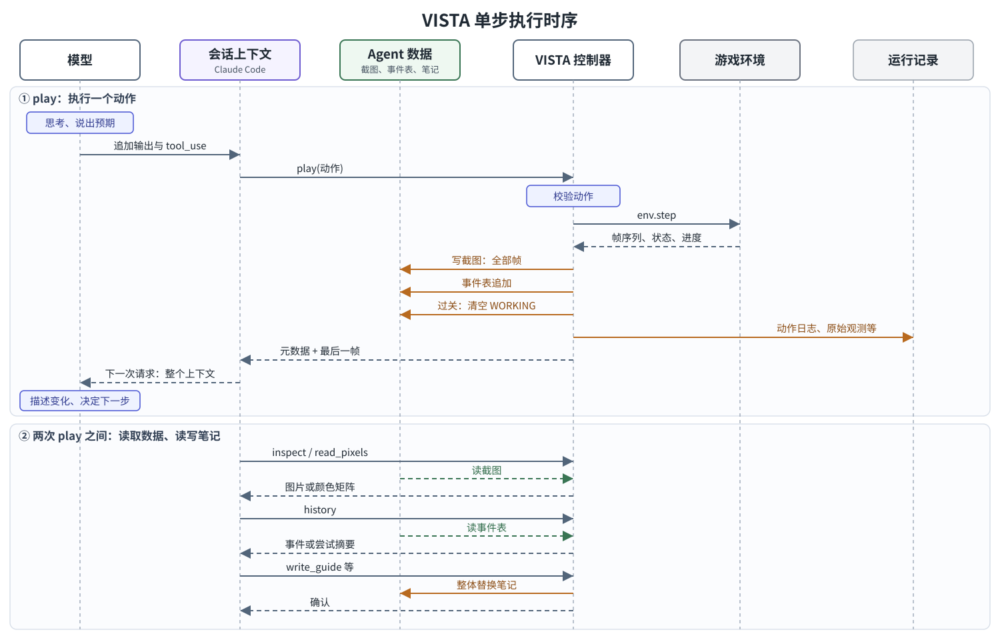
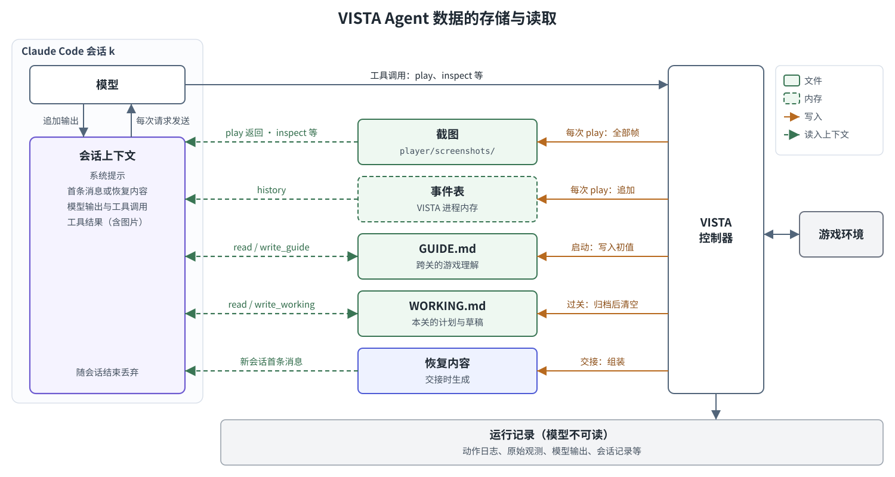
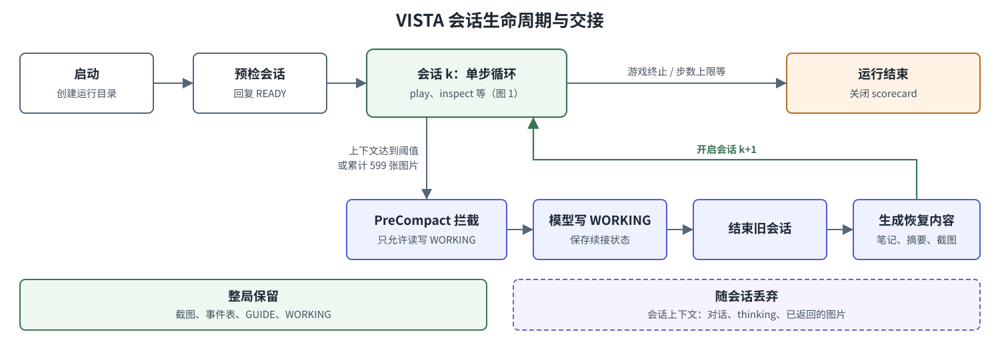

# VISTA 运行时数据流与逻辑流

> 状态：说明文档
>
> 资料日期：2026-10-12
>
> 版本基线：VISTA 上游提交 `c97c354`，本地分支 `local/deepseek-provider`（至 `9743871`）；Claude Code 2.1.220；ARC-AGI-3 profile，Claude 后端
>
> 范围：一局 ARC-AGI-3 游戏运行期间，模型可见的输入与约束、单步执行顺序、Agent 数据的写入与读取，以及会话交接

## 1. 背景

### 1.1 ARC-AGI-3

ARC-AGI-3 是 ARC Prize Foundation 于 2026-03 发布的交互式基准，由回合制抽象游戏组成。环境不提供规则和目标，智能体通过探索推断获胜条件，并把习得的规律迁移到后续关卡。

| 项目 | 内容 |
|---|---|
| 观测 | 64×64 网格，16 色；一次动作可返回多帧（动画） |
| 动作 | ACTION1–5 为按键类动作，ACTION6 为坐标点击，ACTION7 为撤销，另有 RESET |
| 回合 | 一次动作及环境对它的完整响应。环境只在执行动作时推进，两次动作之间游戏状态不变 |
| 计分 | RHAE（相对人类动作效率）：按每关人类基线动作数与智能体动作数之比计分，设上限后平方，后续关卡权重更高 |
| 数据集 | 公开集 25 个游戏，半私有集 55 个，全私有集 55 个 |

### 1.2 VISTA

VISTA 是一个视觉 harness：它把 Claude Code 或 Codex CLI 作为智能体运行时，在其外层提供游戏工具、视觉记忆与会话交接。设计要点如下：

- 环境返回的每一帧都无损保存，模型按回合号与帧号回看历史画面，按区域放大或读取精确颜色；
- 系统提示只有 9 行，不提供游戏规则、示例或策略；
- 禁用智能体运行时的全部内置工具，模型无法执行代码，因此排除程序合成路线。

ARC-AGI-3 之外，VISTA 还接入 GameWorld、AI GameStore 与 BabyVision，这三个场景使用 Codex 后端。本文只描述 ARC-AGI-3 profile 的 Claude 后端。

## 2. 组成

一局运行由三部分协作完成：

| 部分 | 职责 |
|---|---|
| 模型与 Claude Code 会话 | 模型负责推理与决策；Claude Code 维护会话上下文，调用模型 API，并把模型发出的工具调用转给 VISTA |
| VISTA 控制器 | 提供 8 个游戏工具；校验动作、推进环境、保存截图与事件、管理笔记，并在上下文接近上限时组织会话交接 |
| 游戏环境 | ARC 服务器上的游戏实例，经 arc_agi SDK 访问 |

模型与 VISTA 之间只经工具调用交换数据。各部分在宿主机与 Docker 容器中的部署方式和通信链路见第 8 节。

## 3. 模型可见的输入与约束

### 3.1 文字输入

系统提示（`benchmarks/arc3/claude/prompt.md`）以 `--system-prompt` 替换 Claude Code 默认提示，CLAUDE.md、自动记忆与外部配置均被屏蔽：

```text
# Visual game task

Complete the game with as few game actions as possible.

Build and use a compact, revisable model of the game and its current state. Update it as new evidence changes what is supported.

Before each `play`, briefly state what you expect to see. Afterward, briefly state all visible changes, expected or not.

Keep concise, durable, revisable game understanding in `GUIDE.md`; use `WORKING.md` as a scratchpad when useful.
```

其余文字输入：

| 输入 | 时机 | 内容 |
|---|---|---|
| 首条用户消息 | 会话 0 开始 | 当前观测元数据（回合号、状态、关卡进度、可用动作、帧信息）、目标 "Complete the game with as few game actions as possible."、第 0 回合截图 |
| 工具说明 | 每个会话的工具列表 | 动作语义与按键对应、工具参数与上限（3.2 节） |
| 检查点提示 | 压缩前 | "Review and update WORKING.md so it preserves relevant existing information and contains the complete continuation state needed after compaction." |
| 恢复内容 | 新会话开始 | 当前观测、上一次动作结果、本关尝试摘要、GUIDE 与 WORKING 全文、当前截图（第 6 节） |
| 继续提示 | 模型在游戏未结束时停止输出 | "The environment is still active. Context limits are handled automatically. Continue." |
| 错误信息 | 动作或参数非法 | 例如 "RESET is not currently available." |

### 3.2 工具

模型可用的 8 个工具分为四组：

| 工具 | 用途 | 输入 | 返回 | 约束 |
|---|---|---|---|---|
| `play` | 执行动作 | `action`：一个动作名，例如 `ACTION3`（通常对应"左"）；ACTION6 另附坐标 `x`、`y` | 元数据与该回合最后一帧 PNG | 每次调用计一个动作；只接受当前可用动作，GAME_OVER 时只有 RESET 可用 |
| `inspect` | 查看画面 | `question`；`views` 1–16 项 | 每项一张图片，附回合号、帧号与该回合的可用帧范围 | 只返回图片，不含动作信息 |
| `read_pixels` | 测量颜色 | `question`；`views` 1–64 项，每项另需区域划分的行数与列数 | 每项一个颜色符号矩阵与调色板 | 单次至多 4,096 个采样点；只返回测量值 |
| `history` | 查询动作记录 | `view`：`events` 或 `attempts`；`limit` 条数上限；`events` 另可指定回合区间 | 文字记录（见下文） | 条数默认 64、至多 128 |
| `read_guide` / `write_guide` | 读写长期笔记 | 无 / 全文 | 内容 / 确认 | 整体替换，至多 64KB |
| `read_working` / `write_working` | 读写本关草稿 | 无 / 全文 | 内容 / 确认 | 整体替换，至多 16KB；过关时归档并清空 |

**`play`**：`action` 取值为 `RESET` 与 `ACTION1`–`ACTION7`。工具说明给出各动作的常见含义与按键：ACTION1–4 通常对应上、下、左、右（W/S/A/D），ACTION5 为交互类动作（如选择、旋转），ACTION6 为点击，ACTION7 为撤销。具体效果由游戏决定，模型需通过试探确认。ACTION6 的坐标 `x`、`y` 取值 0–511，对应 512×512 截图上的像素位置。示例：`{"action": "ACTION3"}`。

**`inspect` 与 `read_pixels`**：两者参数结构相同。

- `question`：模型用一句话写明这次查看要弄清什么，例如"方块现在位于哪一格"。工具不解析这段文字，它保留在调用记录中，用于让模型先明确目的再取图。
- `views`：取图请求列表。每一项指定一张图，包括回合号 `turn`、该回合内的帧号 `frame`（缺省为最后一帧）、裁剪区域 `region`（缺省为整张图）和一个简短标签 `label`。一次调用可以请求多张图，例如对比不同回合，或放大同一画面的多个局部。

`inspect` 把指定区域裁剪后无平滑放大到 512×512 返回；`read_pixels` 把区域按给定行列数划分为网格，取每格中心像素的颜色，返回符号矩阵。示例：

```json
{
  "question": "What are the key elements: character position, block/target, and any icons?",
  "views": [{"label": "full", "turn": 0}]
}
```

**`history`**：只返回文字，提供两种查询方式。

- `events`：按回合查明细。可用 `start_turn`、`end_turn` 指定回合区间，返回区间内每个回合的动作与结果（状态、关卡进度、可用动作、帧数等），并附可查询的回合范围、匹配总数与是否截断；不指定区间时返回最近的记录。示例：`{"view": "events", "start_turn": 100, "end_turn": 111}`。
- `attempts`：按尝试查概况，只能指定 `limit`。一次尝试指从进入本关或一次 RESET 开始、到 GAME_OVER 为止的一段动作；尚未结束的当前尝试也列出。每条包括尝试序号、起点（进入本关或 RESET）、起止回合、结局与动作数，只统计当前关卡。

`attempts` 用于失败重试的场景。游戏进入 GAME_OVER 后，模型只能 RESET 重新开始本关。此时模型可用 `attempts` 了解本关已失败几次、每次用了多少动作、在哪个回合失败，再以返回的起止回合为区间，调用 `events` 与 `inspect` 回看某次失败的过程。会话交接时，同一份尝试概况作为"本关尝试摘要"写入恢复内容，新会话由此得知此前的失败。一次实际返回（ls20 第 2 关，第 1 次尝试在第 109 回合以 GAME_OVER 结束）：

```json
{
  "view": "attempts",
  "source": "environment action results",
  "level_start_turn": 17,
  "progress": {"completed": 1, "total": 7},
  "attempts": [{"attempt": 1, "start": "level_entry", "start_turn": 17,
                "outcome": "GAME_OVER", "game_actions": 92, "end_turn": 109}],
  "total_attempts": 1,
  "truncated": false
}
```

### 3.3 机制约束

| 类别 | 约束 |
|---|---|
| 能力 | `--tools ""` 禁用全部内置工具；只连接一个 MCP server；禁用 slash command、子 agent 与后台任务 |
| 动作 | schema 校验与可用动作校验；同一回合至多 15 次非法尝试 |
| 预算 | 总步数上限（默认 2000）；单次调用超时；120 分钟无工具调用视为决策租约到期 |
| 上下文 | 达到压缩阈值或单会话累计 599 张图片时交接到新会话（第 6 节） |

### 3.4 决策依据

模型只依据自身上下文决策，harness 不做检索或推荐：

1. 自动送达模型的视觉信息只有每次 `play` 后的最后一帧与元数据；
2. 中间帧、更早画面与动作记录由模型凭回合号主动经 `inspect`、`read_pixels`、`history` 获取，元数据中的 `frame_count` 大于 1 表示该回合有动画帧；
3. Claude Code 在长上下文中削减旧内容，交接后新会话只带恢复内容，此后对早期回合的认识来自笔记与按回合号取回的结果；
4. 笔记的内容与写入时机由模型决定，harness 只在过关时归档并清空 WORKING。

## 4. 单步流程



图 1 以一次 `play` 调用为例，给出各部分之间的消息顺序和数据写入时点。"Agent 数据"指模型可经工具读写的截图、事件表与笔记（第 5 节），"运行记录"指模型不可读的记录（5.5 节）。工具调用经 MCP 转发，图中省略转发环节。

一次 `play` 调用按以下顺序执行：

1. 模型思考并说出预期，输出 `tool_use: play`；Claude Code 把这条输出追加到会话上下文。
2. Claude Code 把工具调用转给 VISTA 控制器。
3. 控制器校验参数与当前可用动作。非法调用返回错误，不推进环境；同一回合至多 15 次。
4. 控制器调用 `env.step`，游戏环境返回本回合的帧序列、状态与关卡进度。
5. 控制器写入 Agent 数据：
   - 回合号加一，把本回合全部帧渲染为 PNG 写入截图目录；
   - 向事件表追加一条记录：动作与结果元数据；
   - 关卡进度增加时，归档 WORKING.md 并清空。
6. 控制器写入运行记录：动作日志、原始观测；SDK 追加录像。
7. 控制器返回元数据与最后一帧 PNG，Claude Code 把它作为 tool_result 追加到会话上下文。
8. Claude Code 发起下一次模型请求，发送整个会话上下文；模型描述可见变化，修正假设，决定下一步。

两次 `play` 之间，模型可以任意调用以下工具，调用路径与 `play` 相同：

| 工具 | 控制器的读写 | 返回 |
|---|---|---|
| `inspect` | 按回合号与帧号读截图，按区域裁剪后无平滑放大到 512×512 | 图片，附回合号、帧号与该回合的可用帧范围 |
| `read_pixels` | 按回合号与帧号读截图，在区域内按行列网格取每格中心像素 | 颜色符号矩阵与调色板 |
| `history` | 读事件表 | `events`：逐回合的动作与结果；`attempts`：本关每次尝试的摘要 |
| `read_guide` / `read_working` | 读笔记文件 | 全文 |
| `write_guide` / `write_working` | 以模型提交的全文整体替换笔记文件 | 确认 |

这些调用不改变游戏状态与回合号。

## 5. Agent 数据的存储与读取



### 5.1 概览

模型每次推理只能看到会话上下文。其余 Agent 数据由 VISTA 控制器保存，模型经工具调用把需要的部分取回，取回结果作为 tool_result 进入会话上下文。图 2 中橙色实线为写入，绿色虚线为读入会话上下文；GUIDE.md 与 WORKING.md 由模型经工具读写。

每次运行生成独立目录 `runs/run_<时间戳>/`。模型可经工具访问的文件位于 `player/`，模型不可读的记录位于 `private/`（权限 700）。

### 5.2 数据对象

| 数据 | 位置 | 写入时点与写入者 | 读取方式 | 保留范围 |
|---|---|---|---|---|
| 会话上下文 | Claude Code 进程内存 | Claude Code 逐条追加：系统提示、首条消息、模型输出（含 thinking 与 tool_use）、tool_result（含图片） | 每次模型请求整体发送；Claude Code 在长上下文中削减旧内容 | 本会话；交接时丢弃 |
| 截图 | `player/screenshots/turn_NNN_frame_MM.png` | 控制器：启动时保存第 0 回合；每次成功执行 `play` 保存本回合全部帧 | `play` 自动返回最后一帧；`inspect`、`read_pixels` 按回合号与帧号读取；交接时取最后一帧 | 整局 |
| 事件表 | VISTA 进程内存 | 控制器：每次成功执行 `play` 追加一条 | `history`；交接时取最后一条作为上一次动作结果，并汇总本关尝试摘要 | 整局 |
| GUIDE.md | `player/GUIDE.md` | 启动时控制器写入初值 "No reliable model yet."；此后由模型经 `write_guide` 整体替换 | `read_guide`；交接时全文进入恢复内容 | 整局 |
| WORKING.md | `player/WORKING.md` | 模型经 `write_working` 整体替换；检查点期间必须写入；过关时控制器归档后清空 | `read_working`；交接时全文进入恢复内容 | 本关 |
| 恢复内容 | 发送给新会话；副本保存在 `private/claude_io/segment_K.input.json` | 控制器在交接时组装（第 6 节） | 作为新会话的首条消息 | 一次 |

各数据的内容与作用：

- **会话上下文**：模型的全部工作记忆。模型看到的画面、动作结果和笔记内容都要先进入上下文才能参与推理。
- **截图**：环境返回的 64×64 网格按 8 倍放大并叠加网格线，渲染为 512×512 PNG，逐帧无损保存。它是模型回看历史画面的唯一来源；动画帧只在模型主动调用 `inspect` 时可见。
- **事件表**：每条记录包含操作序号、回合号、动作（ACTION6 附坐标），以及结果元数据：状态、关卡进度、可用动作、是否过关、帧数等。它是模型查询动作历史的唯一来源，内容只有文字，不含画面。
- **GUIDE.md**：模型对游戏规则与机制的长期理解，跨关保留，至多 64KB。
- **WORKING.md**：模型在本关的计划、预期与待验证的矛盾点，至多 16KB。每次写入时，控制器在 `private/working_memory_provenance.json` 记录写入时的回合号、状态与关卡进度；会话异常重启时，这一记录随 WORKING 全文发给新会话，标明这份草稿保存于哪个回合。过关时 WORKING 归档到 `private/working_memory_archive/` 后清空，新关从空白草稿开始。
- **恢复内容**：把上述数据中与当前局面相关的部分压缩为一条消息，使新会话在丢弃旧上下文后继续游戏。

### 5.3 事件表与动作日志

事件表与动作日志 `private/action_log.jsonl` 在每次 `play` 时同时写入，二者用途不同：

| 项目 | 事件表 | 动作日志 |
|---|---|---|
| 存储 | VISTA 进程内存 | 文件，逐行追加 |
| 记录范围 | 成功执行的动作 | 全部 `play` 调用，含被拒绝的非法调用及其校验结果、控制器错误 |
| 关联字段 | 回合号 | 回合号、`tool_call_id` |
| 读取者 | 模型经 `history`；交接时的控制器 | 运行结束后的分析者 |

事件表是 VISTA 运行时实际读取的数据，因此在图 2 中单独列出。VISTA 进程贯穿一局运行，所有会话共享同一张事件表；一局运行只在一个进程内完成，事件表只保存在内存中。动作日志中成功调用的结果元数据包含事件表的全部内容，进程结束后可由动作日志还原事件表。

### 5.4 数据之间的关联

- 截图与事件以回合号对应：截图文件名中的 `NNN` 即事件中的 `turn`。
- `inspect`、`read_pixels` 只返回画面，`history` 只返回文字；只有 `play` 的返回同时包含本回合的结果与画面。模型需要把动作与画面对照时，按回合号分别调用。
- 同一局的所有会话共享截图、事件表、GUIDE 与 WORKING；会话上下文按会话独立。

### 5.5 运行记录（模型不可读）

VISTA 在运行期间写入以下记录，运行时不回读，供运行结束后核对成绩、分析模型行为、排查故障与统计成本：

| 记录 | 路径 | 内容 | 写入者 |
|---|---|---|---|
| 动作日志 | `private/action_log.jsonl` | 每次 `play` 调用的参数、校验结果与执行结果 | VISTA 控制器 |
| 原始观测 | `private/responses/step_NNNN.json` | 每步的原始数值网格、状态、进度与可用动作 | VISTA 控制器 |
| 录像 | `private/recordings/<scorecard>/*.jsonl` | 每步的时间戳与原始网格 | arc_agi SDK（VISTA 开启录制） |
| 模型输出 | `private/claude_io/segment_K.stdout.jsonl` | thinking、正文、tool_use、tool_result（内嵌 base64 图片）、每次请求的 usage | VISTA 捕获 Claude Code 输出流 |
| MCP 记录 | `private/claude_io/segment_K.bridge.jsonl` | 工具请求与响应，令牌已脱敏 | VISTA |
| 会话记录 | `private/claude_config/projects/-workspace/<session>.jsonl` | Claude Code 自身保存的会话记录 | Claude Code |
| 压缩事件与交接记录 | `private/claude_io/segment_K.compact.jsonl`、`private/compact_recovery.jsonl` | PreCompact / Stop hook 事件；检查点保存、新会话开始、WORKING 归档 | VISTA |
| 运行清单 | `manifest.json` | 运行配置；结束时补充逐关成绩与各会话 usage | VISTA |

文件名中的 `K` 为会话序号。原始观测与截图分开保存：模型只能从画面了解局面，精确数值网格只用于事后核对。

一局 500 步、10 个会话的运行（ls20，DeepSeek）目录合计 301MB：

| 类别 | 大小 | 文件数 |
|---|---|---|
| `private/claude_io/`（stdout、bridge 等） | 232MB | 66 |
| `private/responses/` | 41MB | 501 |
| `private/claude_config/projects/` | 14MB | 10 |
| `private/recordings/` | 11MB | 1 |
| `player/screenshots/` | 3.6MB | 888 |
| `private/action_log.jsonl` | 248KB | 1 |

stdout 的体量来自逐条内嵌的 base64 图片与 thinking 文本；模型可读的截图只占 3.6MB。

## 6. 会话生命周期与交接



一局运行依次经过四个阶段：

| 阶段 | 内容 |
|---|---|
| 启动 | 创建运行目录、AGENTS.md、GUIDE.md 初值与 manifest.json，保存第 0 回合截图 |
| 预检会话 | 只要求模型回复 READY，用于校验工具集、Claude Code 版本与模型 ID |
| 游戏会话 | 会话 0 的首条消息为初始观测与第 0 回合截图；此后每个会话以恢复内容开始，执行图 1 的单步循环 |
| 结束 | 游戏终止、达到步数上限或基础设施失败时关闭 scorecard，manifest 补充逐关成绩与各会话 usage |

交接触发条件与过程：

| 项目 | 内容 |
|---|---|
| 触发 | 上下文达到压缩阈值，或单会话累计发送 599 张图片（VISTA 设定的模型提供方图片上限为 600 张） |
| 压缩阈值 | `CLAUDE_CODE_AUTO_COMPACT_WINDOW` × 90%，且不超过 Claude Code 认定的模型窗口。Anthropic 原生配置为 1M；DeepSeek 配置为 200K，模型窗口经 `CLAUDE_CODE_MAX_CONTEXT_TOKENS` 声明为 1,048,576 |
| 检查点 | PreCompact hook 拦截 Claude Code 的原生压缩，建立检查点请求并向模型注入检查点提示；此期间控制器只执行 `read_working` 与 `write_working`，其他工具调用返回"先更新 WORKING.md"的提示 |
| 写入 WORKING | 模型把续接所需的计划、预期与矛盾点写入 WORKING.md，检查点就绪 |
| 结束旧会话 | hook 再次拦截，结束本轮；该会话 stdout 末尾记为 `aborted_streaming` |
| 生成恢复内容 | 控制器读取 GUIDE 与 WORKING，保存 GUIDE 快照，并从事件表取上一次动作结果与本关尝试摘要；发送前核对 GUIDE 与 WORKING 未被改动 |
| 新会话 | 启动新的 Claude Code 会话，首条消息为恢复内容 |
| 失败判定 | 同一回合连续 3 次交接仍未执行动作 |

检查点请求、就绪与恢复待发送等状态以标记文件保存在 `private/claude_io/`，控制器据此限制工具调用。

恢复内容的组成：

| 部分 | 来源 | 内容 |
|---|---|---|
| Environment record | 控制器状态、事件表 | 当前观测元数据、上一次动作结果、本关尝试摘要 |
| Agent-authored notes | GUIDE.md、WORKING.md | 两份笔记全文 |
| 目标 | 固定文本 | "Continue the game with as few game actions as possible." |
| 图片 | 截图 | 当前回合最后一帧 |

交接前后 Agent 数据的去留：截图、事件表、GUIDE 与 WORKING 整局保留，新会话可按回合号经 `history`、`inspect` 取回交接前的任意记录；旧会话的上下文（对话、thinking、已返回的图片）整体丢弃，只有模型写入笔记的部分随恢复内容延续。

其他恢复路径：

| 情况 | 处理 |
|---|---|
| 模型在游戏未结束时停止输出 | 同一会话注入继续提示 |
| 决策租约到期或会话异常退出 | 以不变的游戏状态开启新会话，同一回合至多 5 次；首条消息与恢复内容相同，WORKING 附写入时的回合号与进度 |
| 模型 API 返回 5xx | 依次退避 10、30、60、120 秒后重试 |
| ARC 平台未返回观测 | 记为 `environment_response_missing`，运行终止 |

运行以 `terminal=true` 结束，且 `termination_reason` 不属于 `compact_recovery_failed`、`controller_error`、`environment_response_missing`、`retry_boundary_interrupt_failed`、`visual_transport_failed` 时，视为正常完成。

## 7. 与 trace 数据模型的对应

| 层级 | VISTA 数据来源 | 关联键 |
|---|---|---|
| 一局 | `manifest.json`、scorecard | 运行目录、scorecard ID |
| 会话 | `segment_K.*`、会话记录 | 会话序号 `K`、Claude Code session ID |
| 模型调用 | stdout 中的 assistant 消息与 usage | 消息 ID |
| 工具调用 | stdout 中的 tool_use / tool_result、bridge 记录 | tool_use ID；动作日志中的 `tool_call_id`（形如 `segment_000:44`） |
| 环境动作 | 动作日志、原始观测、录像 | 回合号 `turn`；录像时间戳 |
| 视觉证据 | 截图 PNG | 回合号与帧号 |

回合号贯穿所有会话，适合作为跨会话关联的主键。长 payload 主要来自 tool_result 中的 base64 图片与 thinking 文本。

## 8. 实现组件

第 2 节的三部分在实现上分布于宿主机与 Docker 容器：

| 组件 | 运行位置 | 职责 |
|---|---|---|
| arc_agi SDK | 宿主机 vista 进程 | 与 ARC 服务器通信、执行动作、写录像 |
| GameController | 宿主机 vista 进程 | 校验动作、推进环境、渲染帧、维护事件表、归档 WORKING、生成恢复内容 |
| Dispatcher | 宿主机 vista 进程 | 执行模型调用的工具，读写笔记；检查点期间限制可用工具 |
| mcp_host | 宿主机 vista 进程 | 接收 MCP 请求，转交 Dispatcher，记录请求与响应 |
| Runner / Lifecycle | 宿主机 vista 进程 | 启动容器、捕获 Claude Code 输出、执行预检、组织交接与恢复 |
| mcp_bridge | Docker 容器 | 以 stdio 方式充当 Claude Code 的 MCP server，转发到 mcp_host |
| Claude Code 2.1.220 | Docker 容器 | 推理循环：调用模型 API、调用 MCP 工具、管理上下文 |
| compact_hook | Docker 容器 | PreCompact 与 Stop hook，在压缩前要求写入检查点 |
| 模型 API | 外部 | Anthropic 原生端点或 Anthropic 兼容端点（如 DeepSeek） |

第 2 节中的"VISTA 控制器"对应 GameController、Dispatcher 与 mcp_host。组件之间的通信链路：

| 链路 | 方式 |
|---|---|
| arc_agi SDK ⇄ ARC 服务器 | HTTP |
| Dispatcher ⇄ mcp_host | 同一进程内调用 |
| mcp_host ⇄ mcp_bridge | Unix socket，跨越宿主机与容器边界 |
| mcp_bridge ⇄ Claude Code | stdio，MCP 协议 |
| Claude Code ⇄ 模型 API | HTTPS |
| Runner → 容器 | 启动容器，捕获 Claude Code 标准输出 |

容器根文件系统只读，去除全部 capabilities。挂载进容器的目录只有 `private/claude_config/`（Claude Code 配置与会话记录）、`private/claude_io/`（hook 事件与标记文件）和 MCP socket 目录；`player/` 与 `private/` 的其余内容只经工具访问。Claude Code 的内置工具全部禁用，模型无法直接读取任何文件。

## 来源

- VISTA 论文：Han et al., *VISTA: A Visual Harness for Reasoning in an Interactive World*, arXiv:2610.02200，<https://arxiv.org/abs/2610.02200>
- VISTA 源码：<https://github.com/joshhhhhan/VISTA>，提交 `c97c354`；`src/vista/benchmarks/arc3/claude/`（prompt、tools、controller、harness）、`src/vista/core/`（dispatcher、session、tools）、`src/vista/backends/claude/`（runner、lifecycle、mcp_host、compact_hook、provider）
- ARC-AGI-3 技术报告：arXiv:2603.24621，<https://arxiv.org/abs/2603.24621>
- arcengine 0.9.3 与 arc-agi 0.9.9（PyPI）
- 运行实测：VISTA 本地运行目录 `runs/run_20261012T040456Z`（ls20，DeepSeek deepseek-flash，500 步）
